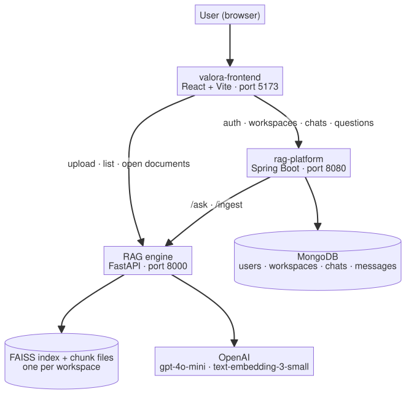
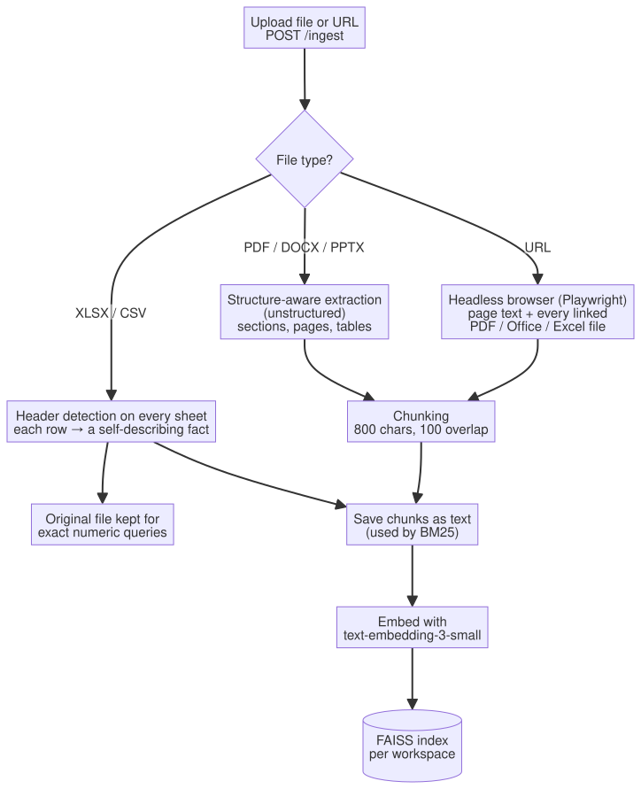
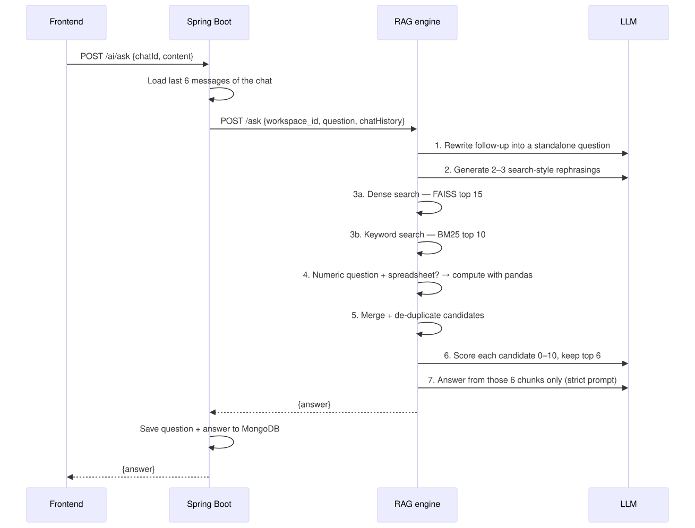

# Valora — Document Q&A with Hybrid RAG


Valora lets you create **workspaces**, upload documents (PDF, Word, PowerPoint, Excel/CSV) or web links, and then **chat with them**. Every answer is grounded in the uploaded content: if the documents don't contain the answer, Valora says so instead of guessing.

Under the hood it is a **hybrid Retrieval-Augmented Generation (RAG)** engine that combines semantic search, keyword (BM25) search, LLM reranking and exact numeric computation over spreadsheets.

---

## Table of contents

- [Architecture](#architecture)
- [How a document is ingested](#how-a-document-is-ingested)
- [How a question is answered](#how-a-question-is-answered)
- [What makes the answers accurate](#what-makes-the-answers-accurate)
- [Tech stack](#tech-stack)
- [Project structure](#project-structure)
- [Running locally](#running-locally)
- [API reference](#api-reference)
- [Evaluating accuracy with Ragas](#evaluating-accuracy-with-ragas)

---

## Architecture

The system has three services:

<p align="center">
  <picture>
    <source media="(prefers-color-scheme: dark)" srcset="docs/images/architecture-dark.svg">
    
  </picture>
</p>

| Service | Responsibility |
|---|---|
| **valora-frontend** | Login/registration, workspace dashboard, document panel, chat UI |
| **rag-platform** | JWT authentication, email verification and password reset, workspaces, chats and message history (MongoDB); forwards questions to the RAG engine together with recent chat history |
| **RAG engine** (repo root) | Document extraction, chunking, embeddings, hybrid retrieval, reranking and answer generation |

---

## How a document is ingested

<p align="center">
  <picture>
    <source media="(prefers-color-scheme: dark)" srcset="docs/images/ingestion-dark.svg">
    
  </picture>
</p>

1. **Extraction.** Each source type has its own extractor:
   - **PDF / Word / PowerPoint**: parsed with `unstructured`, which reads the text layer directly and only falls back to OCR for scanned files. Titles become the *section* of the text that follows, and each element keeps its page number and type. Tables are converted row by row into `header: value` pairs so a row stays readable on its own. Elements are grouped by section and page, small neighbouring groups are packed together, and each chunk is prefixed with its section title so it carries its own context.
   - **Excel / CSV**: every sheet is loaded with automatic header-row detection. Each row becomes a sentence like `product name: widget a. price: 12.5. stock: 40.` — a complete fact that still makes sense when retrieved alone. The original file is also stored for exact calculations (see below).
   - **URLs**: a headless Chromium browser renders the page (so JavaScript-heavy sites work) and indexes its visible text. It then scans **every link on the page** and downloads the PDF / Word / PowerPoint / Excel / CSV files among them, which are ingested like uploads:
     - file type is read from the link's path, so `report.pdf?version=2` counts;
     - links without an extension (e.g. `/download?id=123`) are fetched when they look like downloads, and kept if the server reports a document type;
     - downloads use the browser session (keeping the site's cookies), skip links that return a web page instead of a file, and are stored in a separate folder per URL so names never clash;
     - at most 50 documents are downloaded per page.
2. **Chunking.** Text is split with a recursive splitter into ~800-character chunks with 100 characters of overlap, so sentences cut at a boundary still appear whole in one of the neighbouring chunks.
3. **Storage.** Chunks are written to `data/chunks/compliance_<workspace>/` (for keyword search) and embedded into a FAISS index at `data/embeddings/compliance_<workspace>/` (for semantic search). New uploads are *added* to the existing index, so earlier documents don't need to be re-embedded.

---

## How a question is answered

<p align="center">
  <picture>
    <source media="(prefers-color-scheme: dark)" srcset="docs/images/question-flow-dark.svg">
    
  </picture>
</p>

---

## What makes the answers accurate

Plain "embed the question, fetch the nearest chunks, ask the LLM" RAG fails in predictable ways: follow-up questions lose their meaning, exact terms (IDs, codes, names) get missed, irrelevant chunks dilute the context, and LLMs are bad at arithmetic. Each stage below targets one of those failure modes.

### 1. Conversation-aware question rewriting
A follow-up like *"what about its expiry date?"* is meaningless on its own. The backend sends the last 6 chat messages with every question, and the engine asks the LLM to rewrite the follow-up into a **standalone question** (*"What is the expiry date of the fire safety certificate?"*) before searching.

### 2. Query expansion for retrieval
Users and documents rarely use the same words. The LLM generates **2–3 alternative search phrasings** of the question (without answering it), and these are appended to the original. This widens recall: a chunk written as *"the agreement may be terminated…"* is found for a question about *"cancelling the contract"*.

### 3. Hybrid retrieval: semantic + BM25
Two independent retrievers run on every question:

| Retriever | Good at | Returns |
|---|---|---|
| **Dense (FAISS + embeddings)** | Meaning and paraphrases — "termination" ≈ "ending the contract" | top 15 |
| **Sparse (BM25)** | Exact tokens embeddings blur — policy numbers, product codes, names, acronyms | top 10 |

BM25 is implemented in [`processing/hybrid_retriever.py`](processing/hybrid_retriever.py) with standard parameters (k1 = 1.5, b = 0.75). Combining both retrievers means a chunk only needs to be found by *one* of them to reach the next stage.

### 4. Exact numbers from spreadsheets — computed, not generated
LLMs often get totals and averages wrong. When a question asks for a number (total, sum, average, count, price, stock, revenue, …) and the workspace contains a spreadsheet, [`processing/numeric_aggregator.py`](processing/numeric_aggregator.py) picks the matching column and computes the result directly with **pandas**. The answer is then exact rather than a model's estimate.

### 5. De-duplication
The dense and keyword results often overlap. Candidates are de-duplicated on their content so the same passage doesn't take up several of the limited context slots.

### 6. LLM reranking
Retrieval is tuned for *recall* (don't miss anything); reranking restores *precision*. Each candidate passage is scored **0–10 for how well it answers the question**, and only the **top 6** are passed to the answer step. This removes chunks that merely share keywords with the question.

### 7. Strictly grounded answer prompt
The final prompt ([`rag/prompt.py`](rag/prompt.py)) instructs the model to:
- use **only** the provided context — no outside knowledge, no guessing;
- answer directly when the context contains the answer;
- when only *related* information exists, **say that the exact answer isn't stated** and then give the closest relevant information;
- otherwise reply exactly **"Not found in provided documents."**

All LLM calls run at **temperature 0**, so the same question over the same documents gives the same answer.

### 8. Workspace isolation
Every workspace has its own FAISS index, chunk files and spreadsheet store, and dense search is additionally filtered by workspace ID. Documents from one workspace can never leak into answers in another.

### 9. Structure-preserving extraction
Accuracy starts at ingestion: section titles, page numbers and table rows are kept intact (see [ingestion](#how-a-document-is-ingested)), and every spreadsheet row is turned into a self-contained fact. Retrieved chunks therefore carry the context needed to answer correctly.

---

## Tech stack

| Layer | Technologies |
|---|---|
| Frontend | React 19, Vite, React Router, Tailwind CSS, Axios |
| Backend | Java 17, Spring Boot, Spring Security + JWT, Spring Data MongoDB, Spring Mail |
| RAG engine | Python 3.11, FastAPI, LangChain, FAISS, OpenAI (`gpt-4o-mini`, `text-embedding-3-small`), unstructured, pandas, Playwright |
| Evaluation | Ragas (Answer Accuracy) |
| Database | MongoDB |

---

## Project structure

```
.
├── rag_service.py            # FastAPI app: /ingest, /ask, /documents
├── rag/
│   ├── pipeline.py           # ingestion + hybrid query pipeline
│   └── prompt.py             # grounded answer prompt
├── processing/
│   ├── chunker.py            # recursive text splitter (800 / 100)
│   ├── embedder.py           # OpenAI embeddings
│   ├── hybrid_retriever.py   # BM25 keyword search
│   ├── numeric_aggregator.py # exact sum / average / count with pandas
│   └── llm.py                # chat model (gpt-4o-mini, temperature 0)
├── extractors/               # PDF/Office (unstructured) and Excel extractors
├── loaders/                  # URL loaders (requests + Playwright browser)
├── structured/               # spreadsheet storage, header detection, NL queries
├── vectorstore/faiss_store.py
├── evaluation/ragas_accuracy.py
├── docs/
│   ├── diagrams/             # Mermaid sources of the README diagrams
│   └── images/               # rendered light / dark SVGs
├── rag-platform/             # Spring Boot backend
└── valora-frontend/          # React frontend
```

The README diagrams are SVG images rendered from the Mermaid sources in `docs/diagrams/` (images display reliably everywhere, unlike live Mermaid blocks). After editing a source, regenerate both versions with the shared config, which keeps labels as plain SVG text:

```bash
cd docs
npx -p @mermaid-js/mermaid-cli mmdc -c diagrams/mermaid-config.json -t default -b white   -i diagrams/architecture.mmd -o images/architecture-light.svg
npx -p @mermaid-js/mermaid-cli mmdc -c diagrams/mermaid-config.json -t dark    -b "#0d1117" -i diagrams/architecture.mmd -o images/architecture-dark.svg
```

| Folder | What it is | Port |
|---|---|---|
| `/` (root) | Python RAG engine (FastAPI) | 8000 |
| `rag-platform/` | Spring Boot backend (auth, workspaces, chats) using MongoDB | 8080 |
| `valora-frontend/` | React + Vite frontend | 5173 |

---

## Running locally

**Prerequisites:** Python 3.11, Java 17+, Node.js 20+, MongoDB running on `localhost:27017`, and an OpenAI API key.

Run each part in its own terminal.

**1. RAG engine**

```bash
python -m venv venv
venv/bin/pip install -r requirements.txt fastapi uvicorn python-multipart playwright
venv/bin/playwright install chromium
echo "OPENAI_API_KEY=sk-..." > .env
venv/bin/python -m uvicorn rag_service:app --host 127.0.0.1 --port 8000
```

**2. Spring Boot backend**

```bash
cd rag-platform
cp secrets.properties.example secrets.properties   # then fill in real values
./mvnw spring-boot:run
```

`secrets.properties` holds the Gmail address and app password used for verification emails, and the JWT signing secret. It is git-ignored.

**3. Frontend**

```bash
cd valora-frontend
npm install
npm run dev
```

Open http://localhost:5173, register, verify your email, create a workspace, upload documents and start asking questions.

---

## API reference

### RAG engine (FastAPI, port 8000)

| Method | Endpoint | Description |
|---|---|---|
| `POST` | `/ingest` | Multipart form: `workspace_id`, `files[]` and/or `urls` (comma-separated). Extracts, chunks and indexes the content. |
| `POST` | `/ask` | JSON `{workspace_id, question, chatHistory}` → `{answer}` |
| `GET` | `/documents/{workspace_id}` | List documents in a workspace |
| `DELETE` | `/documents/{workspace_id}/{block_id}` | Remove a document: its vectors, chunk files and stored original |
| `GET` | `/documents/{workspace_id}/{block_id}/open` | Download / view the original file |

Interactive docs are available at http://127.0.0.1:8000/docs.

### Backend (Spring Boot, port 8080)

| Area | Endpoints |
|---|---|
| Auth | `POST /auth/register`, `POST /auth/login`, `GET /auth/verify`, `POST /auth/resend-verification`, `POST /auth/forgot-password`, `POST /auth/reset-password` |
| Workspaces | `POST /workspace/create`, `GET /workspace/my`, `POST /workspace/{id}/upload` |
| Chats | `POST /chat/create`, `GET /chat/workspace/{workspaceId}` |
| Messages | `POST /message/send`, `GET /message/chat/{chatId}` |
| AI | `POST /ai/ask` — `{chatId, content}`; adds recent history, calls the RAG engine and stores both messages |

Workspace and chat endpoints require an `Authorization: Bearer <token>` header (the JWT returned by `/auth/login`).

---

## Evaluating accuracy with Ragas

[`evaluation/ragas_accuracy.py`](evaluation/ragas_accuracy.py) scores a generated answer against a known-correct reference answer using the Ragas **Answer Accuracy** metric (0 = wrong, 1 = fully correct). Use it to measure the effect of pipeline changes on a fixed set of test questions.

```bash
venv/bin/pip install ragas
```

```python
from evaluation.ragas_accuracy import score_answer_accuracy

score = score_answer_accuracy(
    question="What is the policy renewal date?",
    answer="The policy renews on 31 March 2026.",        # answer from /ask
    reference="The policy renewal date is 31 March 2026.",
)
print(score)  # e.g. 0.87
```
